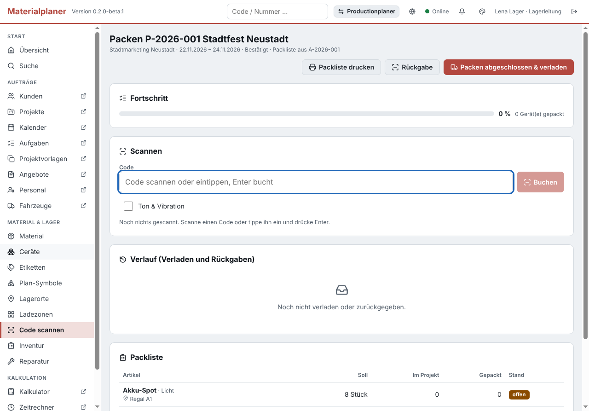
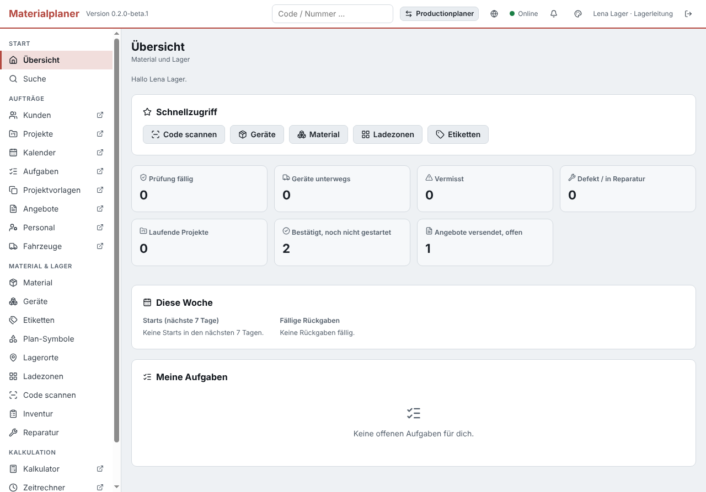
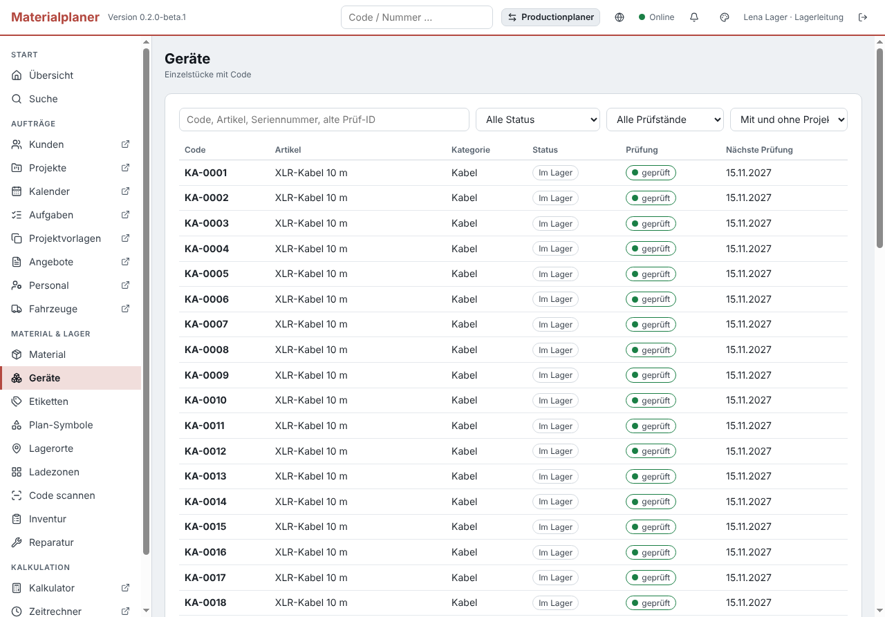
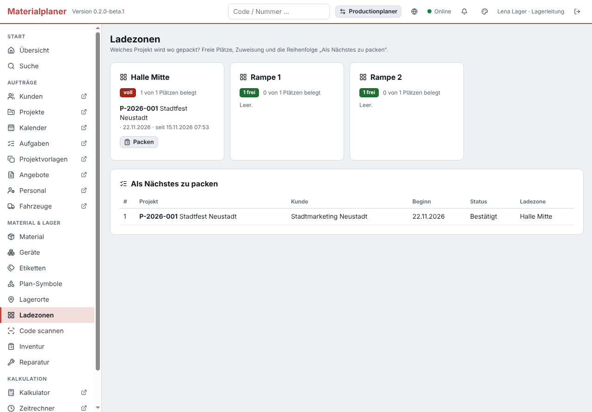
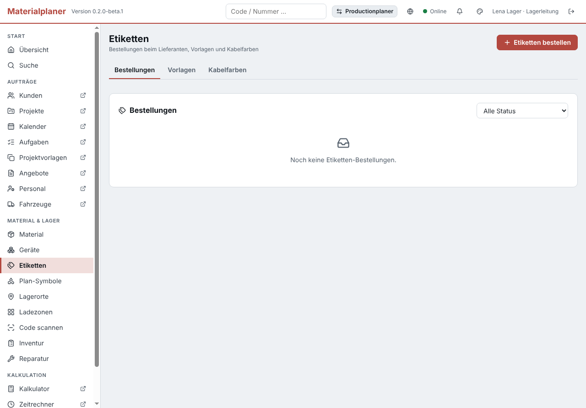

# Materialplaner

Material und Lager für Verleih- und Eventtechnik: Geräte mit Codes, Etiketten, Kabel, Scannen, Packen, Rückgabe, Verladen, Ladezonen, Inventur und Reparatur. Teil der Planer-Familie; arbeitet mit dem [Productionplaner](https://github.com/Nomisimo/Productionplaner) zusammen (ein Konto, Live-Updates, Sprünge an die passende Stelle).

Desktop-App für **Windows und macOS** und dieselbe Oberfläche **im Browser** unter `https://<server>/materialplaner/`. Alle Daten liegen auf dem zentralen Lager-Server ([Planer-Lager-Core](https://github.com/Nomisimo/Planer-Lager-Core)).

> **Beta.** Download unter [Releases](https://github.com/Nomisimo/Materialplaner/releases): Windows (x64), macOS Apple Silicon und macOS Intel. Die Installer sind nicht mit einem Apple- bzw. Windows-Zertifikat signiert (Mac: ad-hoc).
>
> **Erster Start am Mac:** Ab macOS 15: Systemeinstellungen › Datenschutz & Sicherheit › ganz unten „Dennoch öffnen“. Bis macOS 14 geht auch Rechtsklick › „Öffnen“. **Windows:** SmartScreen › „Weitere Informationen“ › „Trotzdem ausführen“.
>
> **Server-Adresse:** Auf der Anmeldeseite unter „Server: … ändern“ die Adresse des Lager-Servers eintragen (bekommst du vom Admin).



## Funktionen

| Menü | Inhalt |
|---|---|
| **Übersicht, Suche** | Kacheln (Prüfung fällig, unterwegs, vermisst, defekt), diese Woche, meine Aufgaben; Suche über beide Apps |
| **Material** | Artikel und Kategorien; mit Anzahl und Kennzeichnung entstehen Geräte samt Etiketten gleich mit |
| **Geräte** | Code, Status, Lagerort, Prüfdatum, Verlauf je Gerät, Filter |
| **Etiketten** | Druck mit der Seitengröße der Vorlage, Designer, Etiketten-Bestellung und Lieferung per Scan, Kabelfarben |
| **Plan-Symbole** | Symbolbibliothek für yEd |
| **Lagerorte** | Regale und Fächer |
| **Ladezonen** | Freie Plätze, Zuweisung, Reihenfolge „Als Nächstes zu packen“, Freigabe nach dem Verladen |
| **Code scannen** | Packen, Rückgabe mit Funktionstest (Taste 1/2), Tasche, vermisst/wieder da, Verladen; Handscanner tippt ohne Klick ins Feld, Netzwerk-Scanner und Bluetooth-Seriell-Scanner, Kamera als Notlösung, Offline-Puffer |
| **Inventur, Reparatur** | Inventur je Kategorie bis zum Protokoll; Defekte, Reparatur und Wartung |
| **Verwaltung** (Admins) | Benutzer, Rollen, Einstellungen, Sicherung, Sicherheit, Arbeitsplätze, Mitarbeiter-PINs, Scanner |
| **Hilfe** | Touren, Tastenkürzel, Kurzanleitung, „Was ist neu?“ |

Einträge mit Pfeil (Kunden, Projekte, Angebote …) öffnen den Productionplaner an der passenden Stelle, ohne neue Anmeldung.

**Arbeitsplatz-Modus:** `Materialplaner --arbeitsplatz` öffnet ein Vollbild-Fenster mit dem Arbeitsplatz-Web des Servers (Packplatz/Rückgabeplatz, Entsperren per PIN). Ohne App geht dasselbe im Browser unter `https://<server>/station`.

**Updates:** Die App zeigt einen Hinweis, wenn auf GitHub eine neuere Version liegt. Klick auf die Versionsnummer oben zeigt „Was ist neu?“.

| | |
|---|---|
|  |  |
|  |  |

## Entwicklung

Der gemeinsame Code (Server, Oberfläche, Electron-Hauptprozess) liegt im Submodule `core/` ([Planer-Lager-Core](https://github.com/Nomisimo/Planer-Lager-Core)).

```bash
git submodule update --init
npm install
LAGER_SERVER_URL=http://localhost:8080 npm start   # Oberfläche bauen, Electron starten (Server aus dem Core: npm run dev:server)
npm test
npm run build:web    # Browser-Version nach dist-web/ (liefert der Server aus)
npm run dist:mac     # .dmg (arm64 + x64)
npm run dist:win     # .exe-Installer (NSIS, x64)
```

Ohne `LAGER_SERVER_URL` fragt die App beim Anmelden nach der Server-Adresse und merkt sie sich im Benutzerordner. E2E-Tests beider Apps laufen im Core (`npm run e2e`).

## Versionen & Release

- Version in `package.json` (SemVer, Betas `0.x.y-beta.n`), immer gleich mit dem Productionplaner. Änderungen je Version in [CHANGELOG.md](CHANGELOG.md); der Abschnitt der laufenden Version erscheint in der App unter „Was ist neu?“.
- **Release:** Version und CHANGELOG in beiden Apps erhöhen, committen, dann unter Actions › Release › „Run workflow“ (oder `gh workflow run release.yml --ref main`). Der Workflow baut Windows x64, macOS arm64 und x64, legt Tag und GitHub-Release mit `latest*.yml` an; Versionen mit Bindestrich werden Vorabversionen.

## Lizenz

Copyright 2026 Nomisimo (Momo). Lizenziert unter der [Apache License 2.0](LICENSE). Siehe auch [NOTICE](NOTICE).
